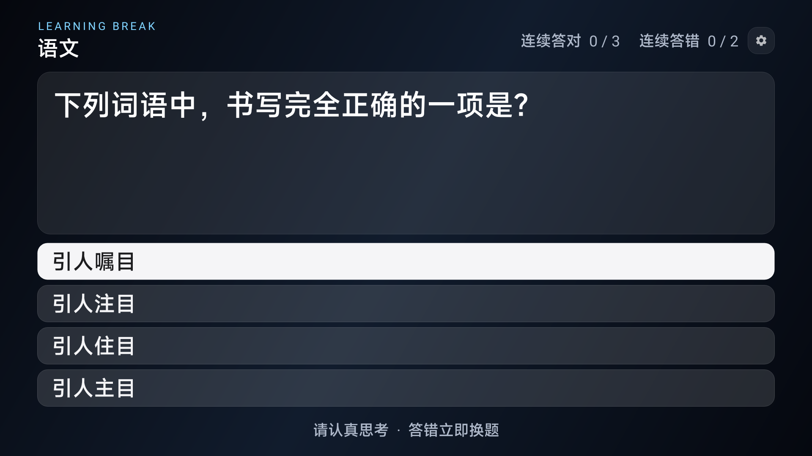

# 学习守护 TV

[](LICENSE)

独立 Android TV 学习守护应用，包名 `com.icybard.learningguard`。不修改、不依赖 Aerial 等桌面应用，不在普通电视桌面显示启动入口。

当前版本：**1.0.0**。内置深圳小学三年级上学期语文、数学、英语各 600 道题，共 1800 道。生产 APK 已签名构建；小米电视上的生产版完整验收、重启恢复和测试包清理状态见[真机验证记录](docs/validation.md)。



## 功能

- 默认累计有效播放 5 分钟后全屏答题，连续答对 3 题后回到原媒体应用。
- 答错后所选项标红、正确项标绿并注明“正确答案”，默认停留 6 秒且锁定答题、返回和齿轮操作，然后才换题；连续答错 2 题也先展示反馈，再默认冷却 120 秒。
- 每题默认限时 60 秒，超时按答错处理并进入同样的答案反馈；可在家长设置中改为 0 关闭，或设为 30～180 秒。
- 使用 AccessibilityService `TYPE_ACCESSIBILITY_OVERLAY` 显示答题层，支持遥控器方向键、确认键；选中项不放大，四个选项统一 24 px 圆角且不显示字母编号。
- 本地保存错题集、最近 20 题及各科本轮覆盖记录。答错立即加入错题集并获得 65% 错题候选池权重，答对即移出；普通答对题在该科全部题目至少出现一次前不再出现，错题可作为加权例外提前重复。
- 答题、答案反馈、冷却剩余时间、播放累计及返回应用信息本地保存；开机接收器负责恢复守护，服务重绑和待机恢复时重新引导前台识别。独立低优先级前台检查服务每 30 秒核对无障碍绑定，普通进程回收后通过 `START_STICKY` 恢复，并保留其他应用的无障碍服务。另注册不上传任何用户数据的本地 SyncAdapter，利用系统设置变化触发 SyncManager；即使应用被强停，也可由系统重新拉起并恢复守护与无障碍绑定，已在目标小米电视上实测。
- WebTV 通过带签名权限的显式绑定服务提供 MediaSession Token，实现真实播放状态、暂停和恢复。
- 云视听极光使用“前台包名 + 系统媒体音频活跃”估算播放；答题时由全屏 Activity 使播放器进入后台生命周期并配合音频焦点实现真实暂停，完成后返回原应用。小米音量等临时系统界面不会覆盖媒体应用的前台判定或中断计时。
- 右上角齿轮和 ADB 自检页生成固定地址二维码；同一局域网内的手机可扫码或收藏 `/setup`，通过六格家长 PIN 输入鉴权后修改规则。
- 支持开关守护、分别开关云视听极光与 WebTV、触发时长 1～120 分钟、连对题数 1～10、冷却时长 30～600 秒、单题限时、答错反馈锁定 3～30 秒、自动恢复和前台播放估算。
- 关闭全局或当前任务所属应用的守护并保存后，立即退出本轮答题或冷却、清零本轮进度，不会在重新开启后恢复旧题。
- 家长页操作结果以当前视口顶部的悬浮提示展示，5 秒后自动消失并可手动关闭，无需滚到页面底部；“查看运行诊断”按行展示服务、前台应用、计时、答题、媒体与错题指标，长状态文本换行且不撑宽手机页面，不直接展示原始 JSON。
- ADB 初始化会备份原设置，并以读取、追加、去重的方式保留其他无障碍及通知监听服务。

## 正式题库

`app/src/main/assets/questions.json` 包含 1800 道原创及程序化生成练习题，不宣称收录某套真题或已由教师逐题审定：

- 语文 600 道：依据人教版三年级上册，覆盖 26 课及字词、句子、阅读、表达等基础能力。
- 数学 600 道：依据北师大版三年级上册，12 个主题各 50 道。
- 英语 600 道：依据沪教深圳 2024 修订版三年级上册，8 个单元各 75 道。
- 每题包含 4 个不同选项、答案、解析、知识点、单元及难度。

题库生成和校验源码位于 `tools/`：

```bash
python tools/generate_questions.py
python tools/validate_questions.py --samples local/question-review-samples.txt
```

校验覆盖题量、ID 与题干唯一性、选项有效性、答案分布、单元覆盖、难度分布、解析及开发残留。分层人工抽样不等同于 1800 题全部人工审定，实际使用前建议家长或教师继续复核。

## 本地构建

需要 JDK 17、Android SDK Platform 36 和 Build-Tools 36.0.0。通过 `ANDROID_HOME` 指定 SDK 位置，或在被 Git 忽略的 `local.properties` 中配置 `sdk.dir`。

在项目根目录使用 Gradle Wrapper 运行单元测试、Release Lint 和 Debug 构建：

```bash
# Linux / macOS
./gradlew :app:testDebugUnitTest :app:lintRelease :app:assembleDebug

# Windows
gradlew.bat :app:testDebugUnitTest :app:lintRelease :app:assembleDebug
```

构建 Release APK：

```bash
./gradlew :app:assembleRelease
```

正式签名配置放在被 Git 忽略的 `local/signing/keystore.properties`，字段为 `storeFile`、`storePassword`、`keyAlias`、`keyPassword`。密钥、密码、PIN、二维码令牌和 APK 均不进入仓库；发布方须妥善备份密钥。未配置签名时不得把生成的包当作正式包发布。

Debug APK：`app/build/outputs/apk/debug/app-debug.apk`。

Release APK：`app/build/outputs/apk/release/app-release.apk`。

## ADB 初始化

先确认电视已授权当前电脑 ADB，再显式指定设备。电视地址只作为命令参数，不写入仓库：

```bash
python deploy/adb/init.py --connect <电视IP:5555>
```

已连接设备也可执行：

```bash
python deploy/adb/init.py --serial <设备序列号>
```

脚本默认安装 Release APK、授予使用情况访问与安全设置权限、允许后台运行、加入系统待机白名单、合并启用守护服务，并启动首次 PIN 设置页。原系统设置备份在被 Git 忽略的 `local-backups/`。如需只恢复初始化而不重装：

```bash
python deploy/adb/init.py --serial <设备序列号> --skip-install
```

脚本不会自动配置 Device Owner、删除账号、停用系统应用或关闭 ADB。小米电视待机或重启后可能关闭网络 ADB；本次验收的 Android 9 电视可在初始化时显式增加 `--keep-adb`，由独立守护定期检查并恢复监听。不传此参数就不会改变既有 ADB 保持配置，Android 11 及以上也不执行该旧式端口恢复。

需要彻底关闭 ADB 时，先关闭保持功能，再关闭系统 ADB，否则守护会按用户此前的选择重新打开：

```bash
adb shell settings put global learning_guard_keep_adb 0
adb shell settings put global adb_enabled 0
```

启用网络 ADB 会扩大局域网调试面，只应在可信家庭网络中按需要开启。本次已在目标 Android 9 电视验证手动关闭后自动恢复，详细记录见真机验证文档。

## 日常家长设置

固定设置地址为 `http://电视IP:18080/setup`。手机与电视在同一局域网时，可收藏该地址，直接打开后在六个独立密码格中输入首次初始化设置的 6 位家长 PIN，支持逐格输入和整段粘贴自动分格。答题页、冷却页及 ADB 自检页的二维码也只包含这个固定地址，不含过期令牌；电视 IP 不变时可长期使用。旧链接中的 `entryToken` 参数会被自动清理，不影响登录。

常规规则修改不需要再次连接 ADB。登录会话 15 分钟有效，过期后重新输入 PIN 即可；连续 5 次登录失败锁定入口 60 秒。

“受控应用”中可分别关闭云视听极光或 WebTV，不影响另一个应用。关闭全局或当前任务所属应用的守护并保存会立即退出本轮；其他规则修改不会自动解除当前任务，保留守护时如需只解除本轮，仍须单独确认。全局关闭后答题页齿轮不再出现，可打开固定地址，或通过 ADB 自检页扫码进入。家长 PIN 不应写入项目文档、截图或 Git 历史。

## 安全边界

- 普通 APK 不能绝对阻止卸载、清数据、恢复出厂、禁用无障碍、进入系统设置或切换外部 HDMI 输入；隐藏入口只降低被发现概率。
- 本地 SyncAdapter 已在目标电视验证手动强停后的自动恢复；清数据、禁用应用、卸载或恢复出厂会删除账户、同步注册或程序本身，无法自行恢复，仍需重新初始化。
- Device Owner、Lock Task、防卸载和防清数据未在本版本配置或验证，不能宣称“任何操作都无法绕过”。
- WebTV 精确控制需要与守护相同的发布签名；签名不同将无法使用签名权限桥接。
- 云视听极光没有源码，其适配依赖当前版本真实播放器行为，不等同于对所有第三方应用通用的 MediaSession 控制。第三方升级后需要重新回归。
- 设置服务使用家庭局域网 HTTP 和固定入口，进入后必须通过家长 PIN 鉴权；不应对公网或不可信网络开放。

## 验证记录

见[小米电视真机验证记录](docs/validation.md)。其中开发版已通过的项目不构成生产版已完成验收的证明。

## 贡献

欢迎通过 Issue 反馈题目错误、设备适配问题或其他缺陷，也欢迎提交 Pull Request。涉及家长 PIN、签名材料、真实设备地址或个人学习记录时，请先脱敏。

## 开源协议

本项目使用 [MIT License](LICENSE)，可以自由使用、修改和分发，但需保留原始版权与许可声明。
